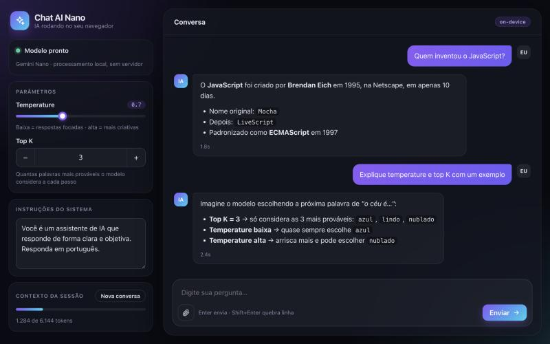
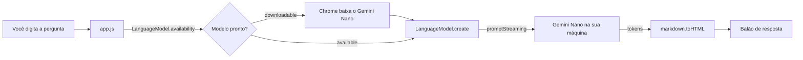

<div align="center">


# Chat AI Nano

**Um chat com IA que roda 100% dentro do navegador.**
Sem servidor, sem chave de API e, depois do primeiro download, sem internet.




<sub>Conversa ilustrativa rodando como extensão, com temperature e top K liberados.</sub>

</div>

---

## Sobre o projeto

O **Chat AI Nano** usa a [Prompt API](https://developer.chrome.com/docs/ai/prompt-api) do Chrome para conversar com o **Gemini Nano**, um modelo de linguagem que o próprio navegador baixa e executa na sua máquina.

Toda a inferência acontece localmente: o texto que você digita não sai do computador, não existe backend e não há custo por requisição. O projeto nasceu numa aula da pós-graduação sobre **IA no navegador (Web AI)** e evoluiu para uma interface de chat completa.

## Funcionalidades

- 💬 **Conversa contínua com streaming**: a resposta aparece token a token e a sessão lembra das mensagens anteriores.
- 🎛️ **Temperature e top K ajustáveis**: liberados quando o projeto roda como extensão do Chrome.
- 🧠 **Instruções do sistema editáveis**: mude a "personalidade" do assistente sem tocar no código.
- 📎 **Entrada multimodal**: anexe uma imagem ou um áudio em inglês, se o navegador suportar.
- ⏹️ **Botão de parar**: interrompe a geração no meio usando `AbortController`.
- 📊 **Uso de contexto**: barra com os tokens já consumidos da janela da sessão.
- 📥 **Progresso do download**: acompanha a primeira instalação do modelo.
- 📝 **Respostas em Markdown**: listas, negrito e código formatados.
- 🌗 **Tema claro e escuro automático** e layout responsivo para celular.
- ✈️ **Funciona offline**: a única biblioteca externa (`markdown`) já vem dentro do projeto.

## Como funciona



O núcleo da integração cabe em poucas linhas:

```js
const session = await LanguageModel.create({
    expectedInputs: [{ type: 'text', languages: ['en'] }],
    expectedOutputs: [{ type: 'text', languages: ['en'] }],
    temperature, // só em extensões
    topK,        // só em extensões
    initialPrompts: [{ role: 'system', content: 'Responda em português.' }],
})

const stream = session.promptStreaming([{ role: 'user', content: question }])
for await (const token of stream) {
    fullText += token
    bubble.innerHTML = markdown.toHTML(fullText)
}
```

### Temperature e top K

A cada passo, o modelo escolhe a próxima palavra entre as candidatas mais prováveis.

| Parâmetro | O que faz | Valor baixo | Valor alto |
|---|---|---|---|
| **Top K** | Quantas candidatas entram no sorteio | Mais previsível | Mais variado |
| **Temperature** | O quanto o sorteio arrisca palavras menos prováveis | Respostas focadas | Respostas criativas |

> [!NOTE]
> A partir do Chrome 138, `LanguageModel.params()`, `temperature` e `topK` só ficam disponíveis em **extensões**. Numa página comum, o app detecta isso, desativa os controles e usa os valores padrão do modelo.

## Requisitos

- **Google Chrome 138 ou superior** no desktop (Windows, macOS ou Linux).
- Hardware compatível com o Gemini Nano. Os requisitos oficiais estão na [documentação do Chrome](https://developer.chrome.com/docs/ai/get-started#hardware). Em resumo, é preciso espaço livre em disco para o modelo (alguns GB) e uma GPU ou CPU com memória suficiente.
- Se a API não aparecer, ative em `chrome://flags`:
  - `#optimization-guide-on-device-model`
  - `#prompt-api-for-gemini-nano`

Não precisa de `npm install`: o projeto é HTML, CSS e JavaScript puro.

## Como executar

### Opção 1: como extensão do Chrome (recomendado)

Libera os controles de temperature e top K.

1. Clone o repositório:
   ```bash
   git clone git@github.com:magnosith/ChatAI-Nano.git
   ```
2. Abra `chrome://extensions` e ative o **Modo do desenvolvedor**.
3. Clique em **Carregar sem compactação** e selecione a pasta do projeto.
4. Clique no ícone do **Chat AI Nano** na barra de extensões para abrir o chat numa aba.

### Opção 2: como página web

Qualquer servidor estático serve. Com o Python que já vem no macOS e no Linux:

```bash
python3 -m http.server 5173
```

Depois acesse [http://localhost:5173](http://localhost:5173).

> [!TIP]
> Na primeira mensagem, o Chrome baixa o Gemini Nano e mostra o progresso no painel de status. Por isso o primeiro envio precisa partir de um clique ou da tecla Enter: o navegador exige uma interação do usuário para iniciar o download.

## Estrutura do projeto

```
ChatAI-Nano/
├── index.html          # Estrutura da interface
├── styles.css          # Visual: tema claro/escuro, layout responsivo, animações
├── app.js              # Lógica: sessão, parâmetros, anexos e streaming
├── manifest.json       # Configuração da extensão (Manifest V3)
├── background.js       # Abre o chat numa aba ao clicar no ícone da extensão
├── lib/
│   └── markdown.min.js # markdown@0.5.0, cópia local para funcionar offline
├── assets/
│   ├── logo.svg        # Logo do projeto
│   ├── logo.png
│   └── icons/          # Ícones da extensão (16, 32, 48 e 128 px)
└── docs/
    └── screenshot.png
```

## Limitações

- **Idiomas:** a API aceita oficialmente `de`, `en`, `es`, `fr` e `ja`. Português ainda não está na lista, então a sessão declara inglês e as instruções do sistema pedem respostas em português. Na prática funciona bem, mas o Chrome não garante a qualidade.
- **Multimodal:** imagem e áudio dependem do suporte do navegador. Se não houver, o botão de anexo fica desativado.
- **Janela de contexto:** a sessão tem um limite de tokens. Quando a barra encher, clique em **Nova conversa**.
- **Só Chrome desktop:** outros navegadores ainda não expõem o `LanguageModel`.

## Créditos

- Projeto inspirado na aula do professor **Erick Wendel** na pós-graduação **Engenharia de Software com IA Aplicada (UNIPDS)**, que apresentou a Prompt API com um exemplo próprio. Interface, logo e funcionalidades extras deste repositório são autorais.
- [Prompt API / Built-in AI](https://developer.chrome.com/docs/ai/built-in) e Gemini Nano, do Google Chrome.
- [markdown-js](https://github.com/evilstreak/markdown-js) para renderizar as respostas.

---

<div align="center">
<sub>@magnodeveloper · Engenharia de Software Mobile · IA</sub>
</div>
